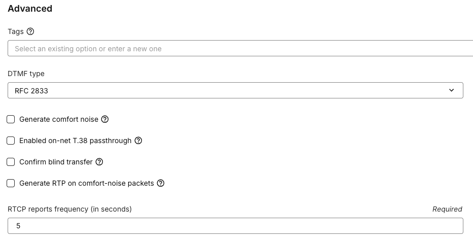

# Configure blind transfer confirmation

A blind transfer redirects a caller or callee to another destination without speaking to that destination first. **Confirm blind transfer** applies to transfers initiated using SIP REFER. When enabled, Telnyx waits for the transfer attempt's outcome before reporting success or failure to your phone system through SIP NOTIFY.

## Before you begin

You need access to edit the SIP connection used by your phone system through the Telnyx Mission Control Portal or API. Your phone system must support blind transfers using SIP REFER and handle transfer-status updates using SIP NOTIFY.

## Enable or disable confirmation

1. In the **Telnyx Mission Control Portal**, open the SIP connection you want to edit.
2. Open **Configuration** and scroll to **Advanced**.
3. Find **Confirm blind transfer**.
4. Select the checkbox to enable confirmation, or clear it to disable confirmation.
5. Save your changes, then reopen the connection to confirm that the checkbox still shows your selection.

The screenshot shows the location of the setting with confirmation **disabled**.

## What changes

| What happens | Selected: confirmation enabled | Cleared: confirmation disabled (default) |
| --- | --- | --- |
| While the destination rings | The original call stays connected while Telnyx waits for the result. | Telnyx reports success immediately and releases the person making the transfer. The caller stays on the line while the destination rings. |
| The destination answers | Telnyx reports success through SIP NOTIFY. The caller connects to the destination, and the transferring party's leg ends. | The caller connects to the destination. No additional transfer-status notification is sent. |
| Telnyx rejects the transfer attempt | Telnyx reports the rejection through SIP NOTIFY and keeps the original call connected. | No additional transfer-status notification is sent after the immediate success report. |
| The destination rejects the call | Telnyx reports the rejection through SIP NOTIFY and keeps the original call connected. | No additional transfer-status notification is sent. The transferring party has already left the call, and the remaining caller is disconnected when the destination rejects the transfer. |

Enable confirmation when you want to keep the original call connected if the destination rejects the transfer. With confirmation disabled, an immediate success report does not mean the destination answered.

With confirmation enabled, ringing or early audio alone does not mean the transfer succeeded and does not trigger a final success notification. An automated service or voicemail can answer a call; confirmation does not distinguish those answers from a person answering.

This option does not turn a blind transfer into an attended transfer, where you speak to the destination before transferring the caller.
