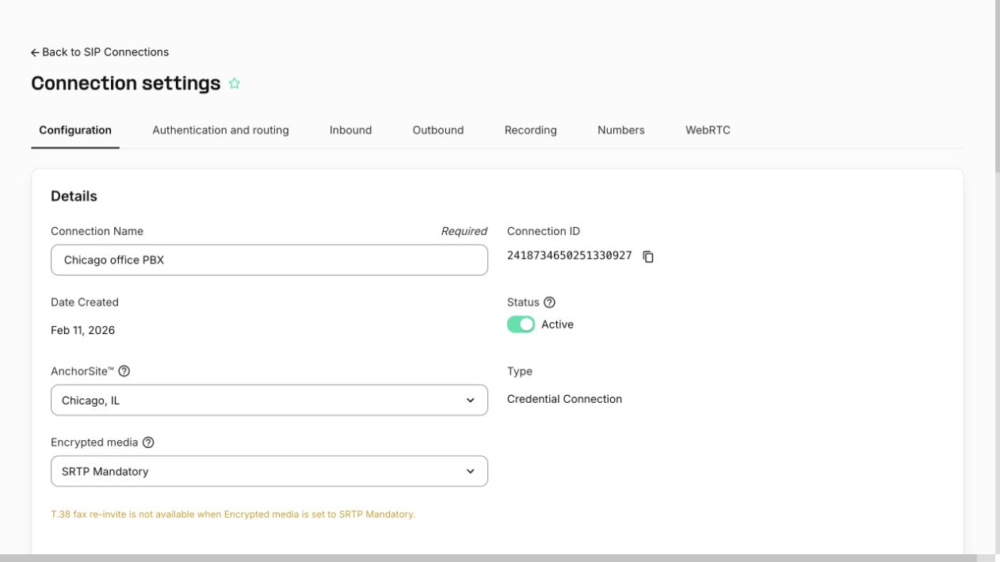
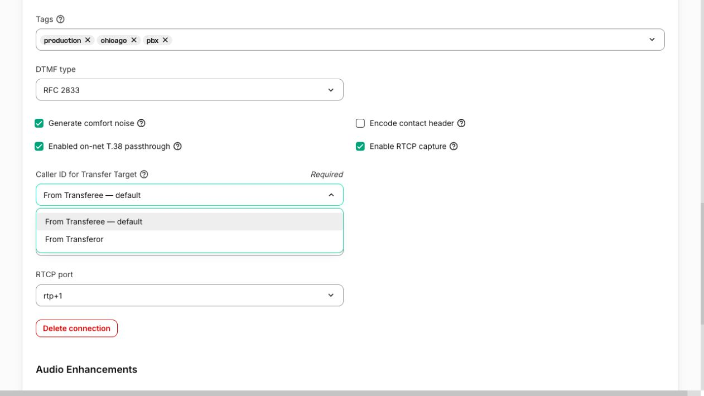

# Choose caller ID for SIP call transfers

**Caller ID for Transfer Target** controls which party’s phone number Telnyx sends to the destination when your phone system transfers a call using SIP REFER. Choose the person being transferred, or the person making the transfer.

The setting belongs to a SIP connection and applies to both inbound and outbound SIP REFER transfers on that connection. It is available for Credential, IP, and FQDN connections when the feature is enabled for the connection. It does not apply to UAC connections or Programmable Voice applications.

## Choose a caller ID mode

| Portal option | Number sent to the transfer destination |
| --- | --- |
| **From Transferee — default** | The number of the party being transferred. |
| **From Transferor** | The number of the party initiating the transfer. |

**From Transferee** is the default. Leaving this selection unchanged preserves the default caller ID behavior.

## Configure the connection

1. Sign in to the **Telnyx Mission Control Portal**.
2. Open **Voice → SIP Trunking** and select the connection used by your phone system.
3. Open the **Configuration** tab.

4. Scroll to **Advanced** and find **Caller ID for Transfer Target**.
5. Select **From Transferee — default** or **From Transferor**.

6. Click **Save**. Reopen the connection and confirm that the saved selection is displayed.
7. Make a test call, transfer it, and check the caller ID number received at the destination.

## Inbound example

An external caller **A** calls your phone system **B** through Telnyx. Your phone system **B** transfers **A** to destination **C**.

| Selection | Caller ID number sent to C |
| --- | --- |
| **From Transferee — default** | **A**, the external caller being transferred. |
| **From Transferor** | **B**, the party making the transfer. |

Choose **From Transferee** when the destination needs to identify the original caller. Choose **From Transferor** when the destination should receive the number of the party making the transfer.

## Outbound example

Your phone system **A** calls customer **B** through Telnyx. Your phone system **A** then transfers **B** to your representative **C**.

| Selection | Caller ID number sent to C |
| --- | --- |
| **From Transferee — default** | **B**, the customer being transferred. |
| **From Transferor** | **A**, the party making the transfer. |

For example, use **From Transferee** when a representative needs the customer’s number to look up their case after answering the transferred call.

## Scope and troubleshooting

The phone system must send a valid SIP REFER within the active call. This setting chooses between the parties in that call; it does not let you enter an arbitrary caller ID number for a new, unrelated call.

The selection controls the **caller ID number**, not the display name or CNAM. When testing, check the received number separately from any displayed name.

If the field is missing, confirm that the connection is a Credential, IP, or FQDN connection and that the feature is enabled for it. Contact Telnyx Support if you need help checking availability.

If the destination receives an unexpected number, confirm that you saved the setting on the connection handling the original call and that the phone system used SIP REFER. A separate outbound call followed by a bridge or a phone-system-managed forwarding flow does not use this SIP REFER setting. The destination’s provider or phone system can also affect how the received number is displayed.
