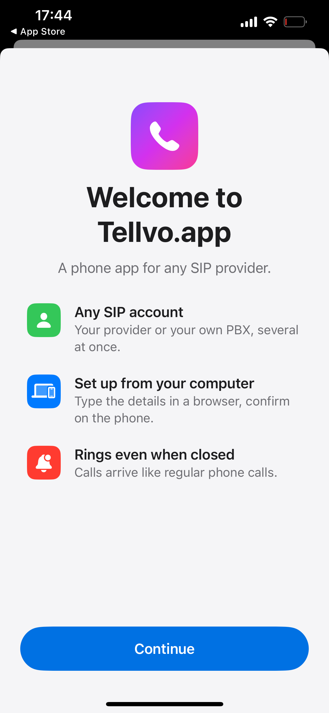
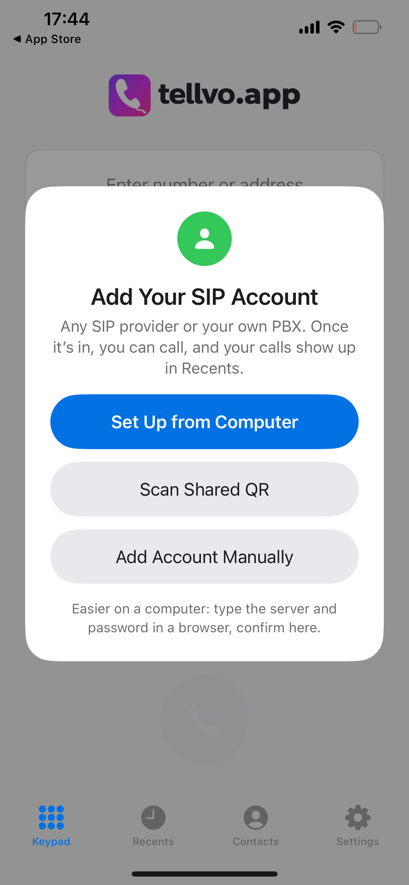
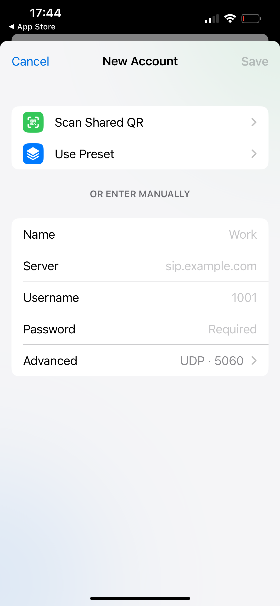
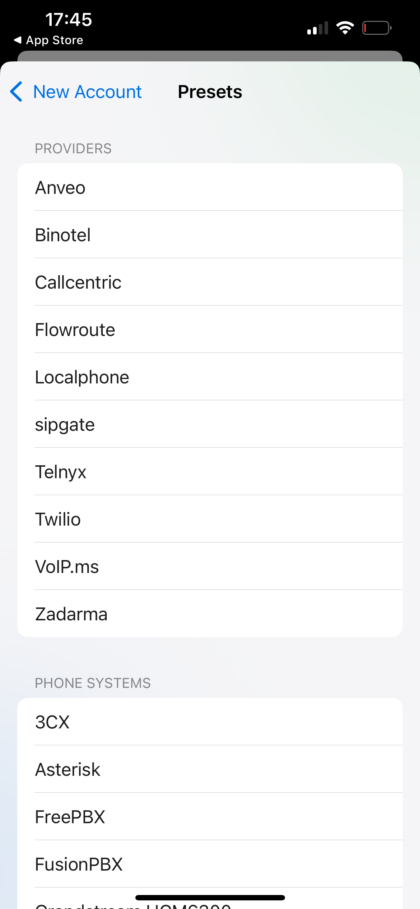
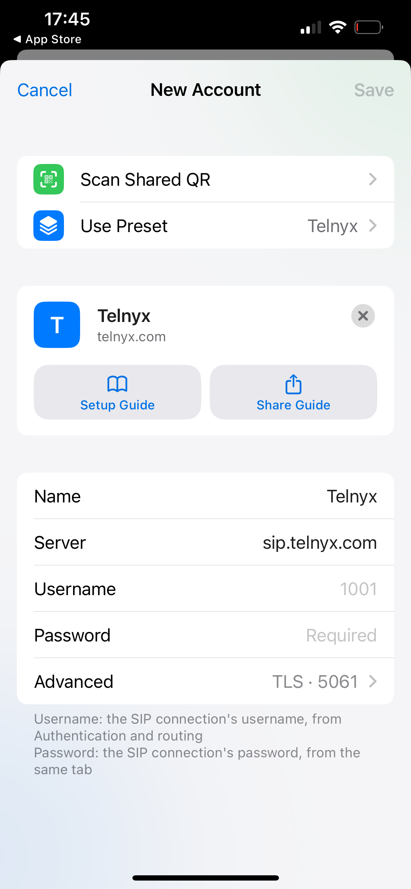
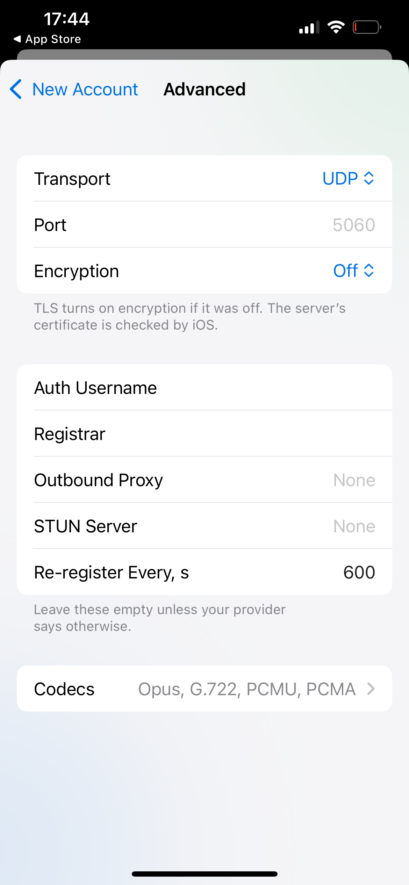

# Tellvo.app: iPhone SIP Softphone Setup

Use Tellvo.app on your iPhone to make and receive voice calls through a Telnyx Credentials SIP Connection. This guide covers Telnyx account preparation, the app's Telnyx preset, and checks for registration and calling.

## Before you begin

- Install [Tellvo.app from the App Store](https://apps.apple.com/app/id6824324858). Check the listing for current device and iOS requirements.
- Have access to your [Telnyx Mission Control Portal](https://portal.telnyx.com/) and a Credentials SIP Connection.
- For inbound calls, have a voice-capable Telnyx number assigned to that connection.
- For outbound calls, attach an Outbound Voice Profile to the connection and allow the destinations you intend to call. See [More about Outbound Voice Profiles](https://support.telnyx.com/en/articles/4320411-more-about-outbound-voice-profiles).

## 1. Prepare your Telnyx connection

1. In Mission Control, open **Voice → SIP Trunking** and create or select a **Credentials** SIP Connection.
2. Open **Authentication and Routing** and find the connection's SIP username and password. Use these credentials in Tellvo.app, not your Mission Control login or an API key.
3. Attach the Outbound Voice Profile you want to use for outgoing calls.
4. In **My Numbers**, select your voice-capable number and assign it to this SIP Connection for incoming calls.
5. For encrypted incoming calls, configure the connection's inbound SIP transport as **TLS** and **Encrypted Media** as **SRTP**. See [Does Telnyx encrypt communication?](https://support.telnyx.com/en/articles/1130711-does-telnyx-encrypt-communication).

TLS protects SIP signaling; SRTP protects audio. Selecting TLS alone does not enable media encryption.

## 2. Add your SIP account in Tellvo.app

### Open the account setup

Open Tellvo.app. On the **Welcome to Tellvo.app** screen, tap **Continue**.

On **Add Your SIP Account**, tap **Add Account Manually**. This opens the account form, where you can select the built-in Telnyx preset.

### Select the Telnyx preset

On **New Account**, tap **Use Preset**. The empty form initially shows placeholder values and **UDP · 5060**; selecting Telnyx fills in the provider settings.

Under **Providers**, tap **Telnyx**.

### Enter your connection credentials

The form now shows the Telnyx provider card, **Name: Telnyx**, **Server: sip.telnyx.com**, and **Advanced: TLS · 5061**.

1. Leave **Name** as `Telnyx`, or enter a label that helps you identify the line.
2. Keep **Server** as `sip.telnyx.com`, unless your deployment uses a regional SIP hostname.
3. Enter your Telnyx SIP Connection's **Username** and **Password** from **Authentication and Routing** in Mission Control. The light-gray `1001` is a placeholder, not a username to copy.
4. Review **Advanced** using the settings below, then return to **New Account** and tap **Save**.

You can also open [Tellvo.app's Telnyx setup guide](https://tellvo.app/setup/telnyx) on your iPhone and tap **Open in Tellvo.app** to start with the preset. If viewing that guide on a computer, scan its QR code with your iPhone. If installation is required first, open the preset link again afterward.

### Review Advanced settings

The screenshot below shows the **initial manual defaults before applying the Telnyx preset**: UDP, port 5060, Encryption Off, and a 600-second registration interval. For the TLS configuration in this guide, use the values in the table instead.

| Field | Telnyx configuration |
| --- | --- |
| Transport | TLS |
| Port | `5061` |
| Encryption | Use the Telnyx preset's SRTP setting; the vendor documents SRTP when offered by the server. Do not leave encryption Off for this setup. |
| Re-register Every, s | `180` |
| Codecs | Opus, G.722, PCMU (G.711 µ-law), PCMA (G.711 A-law) |

For manual setup without a preset, enter the same server and SIP credentials on **New Account**, then configure these Advanced values. Keep the preset's remaining settings unless your deployment requires an override; the additional fields include **Auth Username**, **Registrar**, **Outbound Proxy**, and **STUN Server**.

For a regional SIP hostname, use the appropriate hostname from [Telnyx technical specifications](https://support.telnyx.com/en/articles/1130599-telnyx-tech-specs). Keep the hostname rather than replacing it with an IP address.

After saving, confirm that the line registers. Tellvo documents a green status dot for a registered line; tap the line's status for diagnostic information if registration fails.

## 3. Verify calling

Registration confirms that the line can authenticate; test calling separately:

1. With Tellvo.app open, call a number you control, using full international format such as `+14155550123`. Confirm that the call connects and both parties hear audio.
2. From another phone, call the Telnyx number assigned to the connection. Answer in Tellvo.app and verify audio in both directions.
3. If you need incoming calls while the app is closed, check eligibility for Tellvo's background-ringing service and test that separately. Tellvo uses its push service for this feature; availability depends on its current plan or launch offer. Consult the App Store listing for current terms. Telnyx usage charges still apply.

## Troubleshooting

| Symptom | What to check |
| --- | --- |
| The line does not register | Check the line's diagnostic status, the Credentials connection's username and password, the SIP hostname, and TLS port 5061. |
| Registration succeeds but outgoing calls fail | Check the attached Outbound Voice Profile, destination permissions, account balance, and permitted outbound caller ID. |
| Incoming calls do not reach the app | Confirm that the called Telnyx number is assigned to this connection, the line is registered, and the inbound transport and media settings match. Test with the app open first. |
| Calls ring only while the app is open | Check Tellvo's background-ringing eligibility and app settings, and the iPhone's notification and Focus settings. |
| Audio is missing in one direction | Review firewall/NAT behavior and SIP ALG on your router, compare Wi-Fi with cellular data, and check media-encryption compatibility. TLS registration alone does not verify the audio path. |
